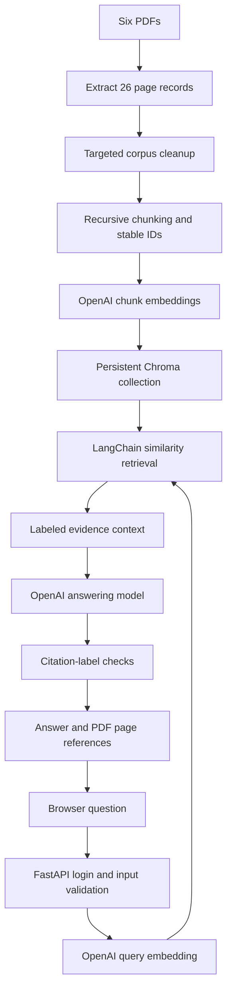

# Healthcare FWA RAG

A retrieval-augmented generation (RAG) assistant that answers questions about
healthcare **fraud, waste and abuse (FWA)** policies, using evidence retrieved
from PDF policy documents and citing the exact source page.

[**Open the live app**](https://healthcare-fwa-rag-demo.onrender.com/) (login required)

> **All data is fictional.** The six source PDFs are fictional teaching
> material. Providers, policies, thresholds, scenarios and financial figures do
> project for real healthcare decisions.

## Contents

- [What it does](#what-it-does)
- [Tech stack](#tech-stack)
- [Architecture](#architecture)
- [Quick start](#quick-start-windows-powershell)
- [HTTP endpoints](#http-endpoints)
- [Corpus and index versions](#corpus-and-index-versions)
- [Rebuild the corpus](#rebuild-the-corpus)
- [Evaluation](#evaluation)
- [Retrieval experiments](#retrieval-experiments)
- [Deployment on Render](#deployment-on-render)
- [Repository layout](#repository-layout)
- [Limitations and further work](#limitations-and-further-work)

## What it does

Ask a policy question in the browser and get a short answer backed by cited
passages (filename, page and chunk). When the corpus does not support an answer,
the assistant says the evidence is insufficient instead of guessing.

**Example:** *What was PRV00092's verified recovered amount?*
→ **12,000  currency units (SCU)**, citing Claims Integrity, page 3.
(The 90,000 SCU candidate paid exposure is a different measure.)

More questions to try:

- When may an exam qualify for separate payment under the dental bundle rule?
- Does three prescribers and two dispensers in 30 days meet the coordination alert rule?
- How should a provider comparison be labeled with 230 accepted lines and eight peer providers?
- How many distinct calendar days are covered by certificates for September 10–12 and September 12–15?
- What is the real penalty for violating the dental bundle rule? *(should return insufficient evidence)*

## Tech stack

| Layer | Choice |
| --- | --- |
| Language | Python 3.12 |
| API and web UI | FastAPI, Uvicorn, a single `index.html` page |
| Orchestration | LangChain (`langchain-core`, `langchain-openai`, `langchain-chroma`) |
| Vector store | Chroma (persistent local snapshot in `data/chroma/`) |
| Embeddings | OpenAI `text-embedding-3-small` (1,536 dimensions) |
| Generation | OpenAI `gpt-4.1-mini` |
| PDF parsing / chunking | `pypdf`, `langchain-text-splitters` |
| Hosting | Render (free web service) |

## Architecture



The served pipeline (`langchain_pipeline.py`) searches the
`healthcare_fwa_policy_v2` collection and retrieves the top three passages. The
reusable Python function accepts an optional source filter; the `/ask` endpoint
searches the whole corpus.

Each retrieved passage gets a temporary citation label. The model's citations
are mapped back to stored source metadata, and an automated check confirms that
every cited label exists. Whether a passage actually supports a claim is checked
by human review during evaluation.

## Quick start (Windows PowerShell)

Requires Python 3.12 (tested with 3.12.14) and an OpenAI API key.

```powershell
git clone https://github.com/danishgaba8-eng/healthcare-fwa-rag.git
Set-Location healthcare-fwa-rag

python -m venv .venv
.\.venv\Scripts\python.exe -m pip install -r requirements.txt

Copy-Item .env.example .env
```

Edit `.env` and fill in:

| Variable | Purpose |
| --- | --- |
| `OPENAI_API_KEY` | Embedding and generation calls (usage is billed) |
| `RAG_APP_USERNAME` | Login for the browser page and `/ask` |
| `RAG_APP_PASSWORD` | Password for that login |

Generate a strong application password if needed:

```powershell
.\.venv\Scripts\python.exe -c "import secrets; print(secrets.token_urlsafe(32))"
```

Start the app:

```powershell
.\.venv\Scripts\python.exe -m uvicorn api:app --host 127.0.0.1 --port 8001
```

Open <http://127.0.0.1:8001/> in Edge or Chrome, sign in with the application
credentials, and ask a question. The bundled Chroma snapshot means you do not
need to re-embed the corpus before the first run. (Browser HTTP Basic prompts may
not appear inside an embedded editor preview.)

## HTTP endpoints

| Method | Path | Auth | Description |
| --- | --- | --- | --- |
| `GET` | `/health` | none | Returns `{"status":"ok"}` |
| `GET` | `/` | login | Browser question page |
| `POST` | `/ask` | login | Answers a JSON question |
| `GET` | `/docs` | none | Generated OpenAPI schema |

Request body:

```json
{"question": "What was PRV00092's verified recovered amount?"}
```

The response contains `answer`, `sources` and `data_notice`. Each source has a
citation label, filename, page number and chunk number. Questions must be
non-blank and at most 2,000 characters. `/ask` logs a request ID, status and
duration, and successful responses include an `X-Request-ID` header. Use HTTPS
whenever the app is hosted, because HTTP Basic credentials are otherwise sent in
clear text.

## Corpus and index versions

The six PDFs cover claims integrity, provider risk, sick-leave FWA, controlled
drugs monitoring, dental FWA, and an original RAG/analytics learning workbook.

| Stage | Result |
| --- | --- |
| Page extraction | 26 page records |
| Fixed-character splitting | 159 chunks |
| Recursive splitting (500 chars, 100 overlap) | 146 chunks → `healthcare_fwa_recursive_v1` |
| Removing the Claims Integrity "RAG test" teaching-answer section | 145 chunks → `healthcare_fwa_policy_v2` (served) |

Both collections are included in `data/chroma/`. Some other instructional
material remains in the corpus, so existing test cases are learning and
development checks rather than an independent benchmark.

## Rebuild the corpus

Rebuilding embeddings makes OpenAI API requests. Keep the committed snapshot as
a baseline before experimenting.

```powershell
# Extract all PDF pages to data/processed/practice_all_pages.json
.\.venv\Scripts\python.exe data/raw/Ingestion.py

# Remove the known teaching-answer section and prepare 145 chunks
.\.venv\Scripts\python.exe clean_policy_pages.py
.\.venv\Scripts\python.exe prepare_policy_chunks.py

# Embed and upsert the chunks into the policy collection
.\.venv\Scripts\python.exe build_policy_index.py
```

`ingest.py` is a separate, validated ingestion exercise that writes
`data/processed/pages.jsonl` plus a source manifest with SHA-256 hashes;
`LINE_BY_LINE.md` explains its code line by line.

Stable chunk IDs prevent duplicates for unchanged chunks, but upserting does not
delete obsolete IDs. When the corpus changes, use a new collection or delete
stale records explicitly.

## Evaluation

```powershell
# Ingestion contract checks (no model calls)
.\.venv\Scripts\python.exe -m unittest discover -s tests -v

# End-to-end question suites (make OpenAI calls)
.\.venv\Scripts\python.exe evaluate_langchain.py --suite development
.\.venv\Scripts\python.exe evaluate_langchain.py --suite validation
```

Results are written as timestamped JSON files under `evaluation/results/`
(git-ignored). To review a run manually:

```powershell
.\.venv\Scripts\python.exe review_results.py --input evaluation/results/YOUR_RESULT_FILE.json
```

The review script records a status and notes per case and saves a separate
reviewed copy.

Recorded observations from small learning runs:

- Three development cases covered verified recovery, a dental exception, and an
  unsupported real-world penalty.
- All five validation cases retrieved the expected source page.
- Manual review: three passes, two needing improvement. The sick-leave answer
  missed the complete overlap rule, and the dental answer over-generalized a
  specialist-review outcome from one example.

These counts come from a handful of runs. They do not establish accuracy at
scale, and generated answers can vary between runs.

## Retrieval experiments

Learning experiments alongside the served similarity-search baseline; they are
not wired into `answer_with_langchain()`.

| Script | Experiment |
| --- | --- |
| `compare_indexes.py`, `compare_answers.py` | Compare the two corpus versions |
| `compare_retrieval_depth.py` | Top-3 vs top-5 retrieval |
| `inspect_sick_leave_chunks.py` | Inspect the expected sick-leave policy page |
| `retrieve_with_neighbors.py` | Expand an anchor chunk with same-page neighbours |
| `hybrid_search_policy_id.py` | Exact policy-ID keyword search, reciprocal rank fusion, heading/body reranking |

Findings: for the sick-leave question, the top hit was page 1 chunk 3 while the
overlap rule sat in chunk 4, and even top-5 retrieval missed it. Adding
neighbouring chunks 2–4 recovered the rule, and the answer correctly cited six
distinct calendar days. For policy ID `DE-P03`, the 60-day rule ranked second in
keyword search and first in vector and hybrid search; the heading/body heuristic
then lifted it above a heading-only result.

## Deployment on Render

```text
Build command:  python -m pip install -r requirements-deploy.txt
Start command:  python -m uvicorn api:app --host 0.0.0.0 --port $PORT
Health check:   /health
PYTHON_VERSION: 3.12.14
```

Set `OPENAI_API_KEY`, `RAG_APP_USERNAME` and `RAG_APP_PASSWORD` in Render's
environment settings (`.env` is never committed). The service reads the Chroma
snapshot bundled in the repository. Render Free discards filesystem changes on
restart and sleeps when idle, so the first request after a pause is slower and
persistent corpus updates would need separate storage.

A hosted smoke test verified `/health` → 200, unauthenticated `/ask` → 401, and
authenticated `/ask` → 200 with the expected amount and page citation.

## Repository layout

```text
api.py                     FastAPI app: browser route, login, /ask, request logging
index.html                 Browser question form with cited sources
langchain_pipeline.py      Served retrieval + answering pipeline
langchain_retrieval.py     LangChain retrieval exercises
rag_pipeline.py            Earlier direct OpenAI/Chroma implementation
ingest.py                  Validated PDF ingestion with manifest and hashes
LINE_BY_LINE.md            Line-by-line walkthrough of ingest.py
requirements-deploy.txt    Pinned runtime dependencies (Render)
requirements.txt           Runtime + ingestion/chunking dependencies
.env.example               Empty credential template
data/raw/                  Six  PDFs and original practice scripts
data/processed/            Extracted pages and chunk records
data/chroma/               Prepared Chroma snapshots (both collections)
evaluation/                Development, validation and draft evaluation questions
tests/                     Ingestion contract tests
```

`.gitignore` excludes credentials, virtual environments, bytecode, traces and
evaluation outputs. `.gitattributes` marks Chroma and PDF files as binary.

## Limitations and further work

- Direct dependencies are pinned; a fully locked transitive environment is not
  yet provided.
- Single shared login. Multi-user use would need individual identities,
  document-level authorization and rate limits.
- Next steps: broader unseen evaluation, removing remaining teaching content
  from the corpus, claim-level evidence checks, prompt-injection tests, bounded
  upstream calls, and backup/restore and rollback rehearsals.
- Possible extensions: agentic retrieval and deterministic calculation tools for
  numeric questions.
