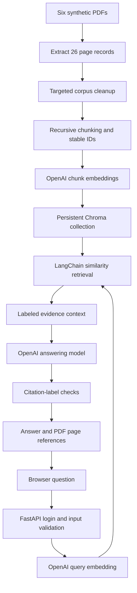

# Synthetic Healthcare FWA RAG

A deployed learning project that answers questions about healthcare fraud,
waste and abuse (FWA) policies using retrieved PDF evidence and page citations.
The corpus contains six wholly synthetic documents. Providers, policies,
thresholds, scenarios and financial figures are fictional teaching examples.
They do not represent actual Department of Health (DOH) data or policy.

[Open the hosted demo](https://healthcare-fwa-rag-demo.onrender.com/)

The browser page and question endpoint require the application login configured
by the service owner. OpenAI API calls incur usage. Render Free can sleep when
idle, so the first request after a pause can take longer.

## Example

**Question:** What was PRV00092's verified recovered amount?

**Expected supported fact:** 12,000 synthetic currency units (SCU), with a
citation to Claims Integrity, page 3. The 90,000 SCU candidate paid exposure
is a different measure.

Other questions to try:

- When may an exam qualify for separate payment under the dental bundle rule?
- Does three prescribers and two dispensers in 30 days meet the coordination alert rule?
- How should a provider comparison be labeled with 230 accepted lines and eight peer providers?
- How many distinct calendar days are covered by certificates for September 10–12 and September 12–15?
- What is the real DOH penalty for violating the dental bundle rule?

The last question should produce an insufficient-evidence answer because the
corpus supplies synthetic training rules.

## Architecture



The baseline uses `text-embedding-3-small` with 1,536-dimensional embeddings,
`gpt-4.1-mini` for generation, and the `healthcare_fwa_policy_v2` collection.
It retrieves three passages, with an optional source filter in the reusable
Python function. `/ask` searches the corpus without a user-selected source filter.

The application gives each passage a temporary citation label and maps the
model's citations to stored source metadata. The automated check verifies that
the cited label exists. Human evaluation checks whether a passage actually
supports the associated claim.

## Corpus and index versions

The six source PDFs cover claims integrity, provider risk, sick-leave FWA,
controlled drugs monitoring, dental FWA, and the original RAG/analytics learning
workbook. The analytics implementation was removed from the project scope.
The workbook remains one of the source documents.

- Six PDFs produced **26 page records**.
- Fixed-character splitting produced **159 chunks**.
- Recursive splitting produced **146 chunks** using a 500-character target
  and 100-character overlap.
- Removing the Claims Integrity `RAG test` teaching-answer section produced
  **145 chunks** in `healthcare_fwa_policy_v2`.
- `healthcare_fwa_recursive_v1` preserves the original 146-chunk baseline.

The repository includes the prepared synthetic Chroma snapshot so local startup
does not require re-embedding the corpus. The targeted cleanup removed one
known answer section. Additional instructional material remains in the corpus,
and the existing cases are learning/development checks.

## Quick start on Windows PowerShell

Use Python 3.12. The project was tested with Python 3.12.14.

```powershell
git clone https://github.com/danishgaba8-eng/healthcare-fwa-rag-demo.git
Set-Location healthcare-fwa-rag-demo

python -m venv .venv
.\.venv\Scripts\python.exe -m pip install -r requirements.txt

Copy-Item .env.example .env
```

Edit `.env` locally and fill in `OPENAI_API_KEY`, `RAG_APP_USERNAME`, and
`RAG_APP_PASSWORD`. Generate a strong application password if needed:

```powershell
.\.venv\Scripts\python.exe -c "import secrets; print(secrets.token_urlsafe(32))"
```

Start the app from the repository root:

```powershell
.\.venv\Scripts\python.exe -m uvicorn api:app --host 127.0.0.1 --port 8001
```

Open `http://127.0.0.1:8001/` in Edge or Chrome, sign in with your application
credentials, and ask a question. The username and password are separate from
the OpenAI API key. Browser HTTP Basic authentication prompts may be unavailable
in an embedded editor preview.

The requirements pin direct dependency versions. A fully locked transitive
dependency environment is a future improvement.

## HTTP endpoints

- `GET /health` returns `{"status":"ok"}` and is available without login.
- `GET /` serves the browser interface after login.
- `POST /ask` accepts a JSON question after login.
- `GET /docs` exposes the generated API schema.

Example request body:

```json
{"question": "What was PRV00092's verified recovered amount?"}
```

The response contains `answer`, `sources`, and `data_notice`. Each source
contains a citation label, filename, page number, and chunk number. The API
rejects whitespace-only questions and enforces a 2,000-character input limit.

Logs for `/ask` include a request ID, status, and duration. Successful handled
responses include an `X-Request-ID` header. HTTPS should protect hosted
HTTP Basic credentials.

## Rebuild the learning corpus

Run these commands from the repository root. Rebuilding embeddings makes
OpenAI API requests. Keep the checked-in snapshot available as the baseline
before experimenting with a rebuild.

```powershell
# The original lesson script extracts all PDF pages to practice_all_pages.json.
.\.venv\Scripts\python.exe data/raw/Ingestion.py

# Remove the known embedded teaching-answer section and prepare 145 chunks.
.\.venv\Scripts\python.exe clean_policy_pages.py
.\.venv\Scripts\python.exe prepare_policy_chunks.py

# Embed and upsert the prepared chunks into the policy collection.
.\.venv\Scripts\python.exe build_policy_index.py
```

`ingest.py` is a separate validated ingestion exercise that writes `pages.jsonl`
and a source manifest. `LINE_BY_LINE.md` explains its code. The preprocessing
lesson uses `practice_all_pages.json`, so the two entry points have different
output formats.

Stable IDs prevent duplicate records for unchanged chunks. The upsert exercise
does not remove obsolete IDs. Use a new collection or explicit deletion when
changing the corpus to avoid retaining stale evidence.

## Evaluation

```powershell
.\.venv\Scripts\python.exe -m unittest discover -s tests -v
.\.venv\Scripts\python.exe evaluate_langchain.py --suite development
.\.venv\Scripts\python.exe evaluate_langchain.py --suite validation
```

The ingestion checks use the actual synthetic corpus and run without model
calls. The evaluation commands make embedding and generation requests and save
timestamped JSON results under `evaluation/results/`.

For manual review, select a specific result file:

```powershell
.\.venv\Scripts\python.exe review_results.py --input evaluation/results/YOUR_RESULT_FILE.json
```

The review script asks for a status and notes, then writes a separate reviewed
copy. Its automatic file selection finds development runs; use `--input` for
a validation run.

Recorded learning observations:

- Three development cases covered verified recovery, a dental exception,
  and an unsupported real-world penalty.
- Five validation cases searched across the whole corpus. All five retrieved
  the expected source page in that run.
- Manual review found three passes and two answers needing improvement.
  The sick-leave answer lacked the complete cited overlap rule. The dental
  answer generalized a specialist-review outcome from a specific example.

These counts describe small observed runs. They do not establish population
accuracy or readiness for real healthcare decisions. Generated answers can
vary across runs.

## Retrieval experiments

These scripts are learning experiments alongside the hosted similarity-search
baseline. They have not been integrated into `answer_with_langchain()`.

- `compare_indexes.py` and `compare_answers.py` compare corpus versions.
- `compare_retrieval_depth.py` compares top-three and top-five retrieval.
- `inspect_sick_leave_chunks.py` inspects the expected policy page.
- `retrieve_with_neighbors.py` expands an automatically selected anchor with
  same-page neighbors and generates an answer from the expanded evidence.
- `search_policy_id.py` and `hybrid_search_policy_id.py` explore exact policy
  identifiers, reciprocal rank fusion, and heading/body reranking.

For sick leave, the top result was page 1, chunk 3, while the overlap instruction
was in chunk 4. Top-five retrieval still missed the exact rule. Adding chunks
2–4 recovered it, and the answer cited the overlap instruction for six distinct
calendar days. For `DE-P03`, the actual 60-day rule ranked second in keyword
search and first in vector and hybrid search. The keyword heuristic then moved
the rule above a heading-only result.

## Render deployment

The service uses the repository root with:

```text
Build command: python -m pip install -r requirements-deploy.txt
Start command: python -m uvicorn api:app --host 0.0.0.0 --port $PORT
Health check: /health
PYTHON_VERSION: 3.12.14
```

Set `OPENAI_API_KEY`, `RAG_APP_USERNAME`, and `RAG_APP_PASSWORD` using Render's
environment settings. The `.env` file is excluded from Git. The deployed snapshot
uses a local Chroma directory bundled with the release. Render Free discards
runtime filesystem changes on restart, so persistent corpus updates require
a separate deployment/storage design.

The hosted smoke check verified health 200, unauthenticated `/ask` 401, and
authenticated `/ask` 200 with the expected amount and page citation. The local
staging check used the same Windows Python environment. Hosted verification
then exercised the Linux deployment and copied Chroma snapshot.

## Repository layout

```text
api.py                         HTTP API, browser route, login and request logging
index.html                     Browser question form and cited sources
langchain_pipeline.py          Hosted retrieval and answering implementation
rag_pipeline.py                Earlier direct OpenAI/Chroma implementation
requirements-deploy.txt        Pinned direct runtime dependencies
requirements.txt               Runtime plus ingestion/chunking dependencies
.env.example                   Empty credential fields for local setup
data/raw/                      Six synthetic PDFs and original practice scripts
data/processed/                Prepared synthetic pages and chunk records
data/chroma/                   Prepared original and policy index snapshots
evaluation/                    Development and validation questions
tests/                         Ingestion contract checks
```

Local credentials, Python environments, bytecode, traces and evaluation outputs
are excluded by `.gitignore`. `.gitattributes` preserves Chroma and PDF files
as binary data.

## Further work

Broaden unseen evaluation, remove remaining teaching content, add claim-level
evidence checks, and compare retrieval experiments across the full test set.
For multiple users, add individual identities, document authorization, rate
limits, bounded upstream calls, prompt-injection tests, backup/restore and
rollback rehearsals. Agentic retrieval and structured calculation tools remain
possible extensions. The analytics platform implementation is outside scope.
